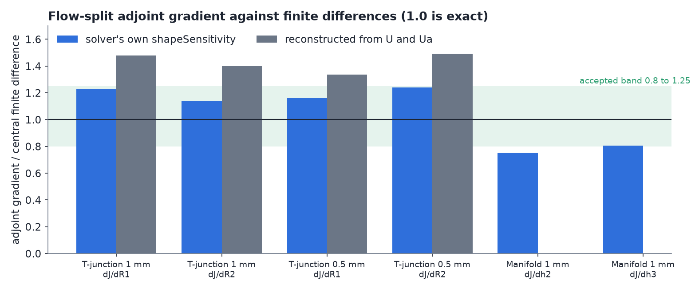
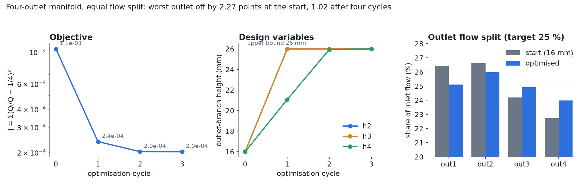

# of14-adjoint

A continuous-adjoint shape-sensitivity solver for **OpenFOAM 14** (the OpenFOAM Foundation
release), built for Windows with the FoamWin MinGW-w64 toolchain and on Linux with the ordinary
`wmake`. It starts from the Foundation's own `adjointShapeOptimisationFoam` and brings in pieces of
ESI-OpenCFD's adjoint optimisation library (OpenFOAM v2xxx, `src/optimisation`), which the
Foundation release does not have.

This is an independent community project. It is not part of, approved by or endorsed by the
OpenFOAM Foundation or OpenCFD Ltd. OPENFOAM® is a registered trade mark of OpenCFD Limited.

## What it does

`adjointFoam` solves a steady incompressible flow (SIMPLE) and its continuous adjoint for one of
two objectives, chosen by `objective { type ...; }` in `system/adjointDict`:

- `ptLosses` (the default, and what runs when there is no `objective` block): the total-pressure
  loss between inlets and outlets (Othmer 2008), with the Foundation's outlet conditions;
- `flowRatePartition`: J = Σᵢ (Qᵢ/Q − Tᵢ)² over chosen outlets (Q their summed flux, Tᵢ = 1/N by
  default), with the outlet conditions `objectiveOutletPressure` and `objectiveOutletVelocity`
  after ESI's and Ua = 0 at the inlets (laminar, measured against finite differences in
  [tests/flowsplit.md](tests/flowsplit.md));

and writes:

- `U`, `p`, `Ua`, `pa` as usual;
- **`shapeSensitivity`** on every wall patch: the change of the objective per unit area and per unit
  displacement of the wall along its normal pointing out of the fluid, from OpenFOAM's own boundary
  normal gradients;
- `postProcessing/adjoint/0/objective.dat`: the objective each iteration.

Compared with the Foundation solver it starts from:

| | Foundation `adjointShapeOptimisationFoam` | `adjointFoam` |
|---|---|---|
| Purpose | topology optimisation by porosity | shape sensitivity (porosity optional, off by default) |
| Adjoint transpose convection | always the full term (diverges on a turbulent pitzDaily without porosity) | `ATC` choice from ESI: `UaGradU` (default, the same term), `standard`, `cancel`, with ESI's limiter next to chosen patch types: `zeroATCPatchTypes (patch)` makes that case stable ([tests/atc.md](tests/atc.md)) |
| Wall sensitivity | none | `shapeSensitivity` written per wall face |
| Inlets | a patch named `inlet` | every non-wall patch with a plain fixed-value U |
| Inlet adjoint velocity | as given | as given (the pressure-loss objective wants `-U_in`; the flow-rate objective `0`, checked) |
| Objective | total-pressure loss, hard-coded in the outlet conditions | `ptLosses` (the same) or `flowRatePartition` (ESI's, with its outlet conditions) |

Settings: `system/adjointDict`, every entry optional ([etc/adjointDict](etc/adjointDict)). The plan for the ESI merge, in order, is in [ROADMAP.md](ROADMAP.md).

## How accurate is it

The flow-rate objective's gradient points the right way but is not yet accurate in size. Against
central finite differences of J, with the solver's own `shapeSensitivity`, the ratio is 1.14 to 1.24
on a snapped T-junction and 0.75 to 0.81 on a four-outlet manifold (1.0 is exact; the grey bars are
the reconstruction Stokes used before it read the solver's field). It is experimental and not
called verified. Every experiment is in [tests/flowsplit.md](tests/flowsplit.md).



For scale, this is the optimisation the gradient is meant to serve: Stokes equalising the flow
across the four outlets of a manifold by moving three branch heights. That run used finite-difference
gradients (16 flow solves), not this adjoint; the worst outlet went from 2.27 points off an equal
split to 1.02 and J fell by 81 %, stopping at the 26 mm bound of the design variables.



## Build

```bash
# Windows binaries, from Linux or WSL, against a built FoamWin tree:
FOAMWIN_SRC=~/foamwin-clean/OpenFOAM-14 bash /path/to/of14-adjoint/build.sh   # -> bin/adjointFoam.exe
# (call build.sh by a path with a slash: it finds its directory from $0)
```

Copy `bin/adjointFoam.exe` beside the install's other solvers. On Linux, source an OpenFOAM 14
`etc/bashrc` and run `wmake` in `applications/adjointFoam` with `EXE` set to taste.

## Licence and provenance

GPL-3.0-or-later, as OpenFOAM itself ([LICENSE](LICENSE)). Every file keeps the copyright header of
the code it came from; [NOTICE.md](NOTICE.md) lists which file came from where.
